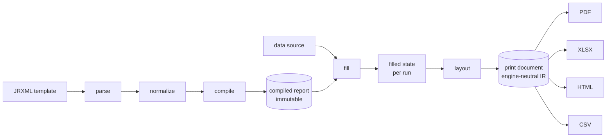

# Architecture

> **Status: proposal.** Engine functionality is limited to a few M0 contracts
> (diagnostics, limits, expression symbols, print model/unit, datasource cursor,
> test helpers); everything else is unimplemented. This document describes the
> intended structure, invariants and contracts so future changes can implement
> them in small, reviewable steps. Packages with only a `doc.go` are stubs;
> proposed packages are labelled *proposed*.

This supersedes the earlier bootstrap document previously at
`docs/architecture.md` (merged here). The architectural principles and package
responsibility table from that document are preserved below.

## Principles

- **Library first.** The reporting engine is a native Go library that can be
  embedded in an application. The CLI and any future server adapter are thin
  consumers of the same core.
- **No JVM at runtime.** The engine targets pure-Go execution. Any Java-based
  reference tooling is a separate, optional testing concern (see
  [`COMPATIBILITY.md`](COMPATIBILITY.md)).
- **Immutable compiled reports, isolated fill state.** A compiled report is
  immutable and safe to reuse. Each fill execution owns its own mutable state.
- **Engine-neutral print IR.** The print document is the boundary between
  layout and exporters. Exporters consume the print document and know nothing
  about JRXML, expressions or data sources.
- **Deterministic, cancellable, bounded.** Runs accept a `context.Context` and
  resource budgets; output is deterministic for fixed inputs, fonts, locale and
  timezone. See [`architecture/concurrency-and-limits.md`](architecture/concurrency-and-limits.md).

## Canonical lifecycle

```text
JRXML / other future definitions
      ↓
Version-aware parser → normalization → validation / compiler
      ↓
Immutable compiled report IR (+ optional compilation cache)
      ↓
Data acquisition / record iteration + typed expression evaluation
      ↓
Report filling: groups, variables, bands, deferred evaluation, subreports
      ↓
Layout, text measurement, pagination
      ↓
Print IR / paginated document (possibly backed by spill-to-disk storage)
      ↓
Pluggable exporters: PDF first; XLSX, HTML, CSV later
```



The stages are deliberately ordered: parsing and data sources feed compilation
and filling; layout produces the print representation; exporters consume it.

## Major invariants

1. **Directional, acyclic package graph.** Imports flow inputs → output. No
   cycles. See [`architecture/package-boundaries.md`](architecture/package-boundaries.md).
2. **Compiled IR is immutable and shareable.** It contains no per-run state and
   may be cached and used concurrently.
3. **Fill state is per-run and never shared.** Concurrent fills of the same
   compiled report are safe.
4. **Print IR is the only thing exporters see.** Exporters must not import
   parser, compiler, expression or fill packages.
5. **No hidden I/O.** Network, filesystem and database access happen only
   through explicit, injectable resources and are cancellable.
6. **Determinism.** Same inputs + same pinned environment ⇒ byte-stable output
   (within documented exporter tolerances).
7. **No arbitrary code execution.** Expressions are evaluated by a bounded
   interpreter, never by running Go/Java code.

## Package responsibilities

Existing packages. Several now carry contracts; those with only a `doc.go` are
marked *stub*.

| Package | Responsibility | Intended dependencies | State |
| --- | --- | --- | --- |
| `cmd/gosper` | CLI front end (metadata only today). | `report` (proposed) | Metadata implemented |
| `internal/diag` | Diagnostics: error codes, severity, source spans. | stdlib | Contract implemented |
| `internal/limits` | Resource budgets, cancellation plumbing. | `diag` | Contract implemented |
| `internal/expression` | Parse and evaluate report expressions. | `diag` | Value/symbol contracts implemented |
| `internal/datasource` | Pluggable business data providers. | stdlib | Cursor contract implemented |
| `internal/printdoc` | Engine-neutral print document model. | stdlib | Model + unit implemented |
| `internal/testutil` | Deterministic test environment helpers. | stdlib | Implemented |
| `internal/jrxml` | Parse JRXML XML into a template model. | `internal/diag` | Stub |
| `internal/compiler` | Validate and produce an immutable compiled report. | `jrxml`, `expression`, `diag` | Stub |
| `internal/fill` | Execute a compiled report; hold per-run state. | `compiler`, `expression`, `datasource`, `limits` | Stub |
| `internal/layout` | Lay filled data into pages; text measurement. | `fill`, `printdoc`, `text` | Stub |
| `internal/exporter` | Render a print document to output formats. | `printdoc` | Stub |

Proposed additional packages (see
[`architecture/package-boundaries.md`](architecture/package-boundaries.md)):

| Package | Responsibility |
| --- | --- |
| `report` (module root) | Public SDK facade: `Compile`, `Fill`, `Export`, convenience. |
| `internal/resources` | Resource resolution (templates, images, fonts, URIs). |
| `internal/text` | Font resolution, metrics, shaping, line breaking. |
| `internal/cache` | Optional compilation cache with versioned keys. |
| `internal/exec` | Orchestration of compile → fill → layout → export. |

## Public API surface

There is intentionally **no public `pkg/` hierarchy**. A stable public API
belongs at the module root (package `report`, *proposed*) and is introduced with
its first real consumer. Prefer immutability, explicitness and small interfaces.
The API contract is tracked by `FND-001` and defined by task
`FND-001-001`.

## Consumers

The same core serves three deployment shapes:

- **Embedded library** — applications import the module directly.
- **CLI** (`cmd/gosper`) — a local command-line front end, currently metadata only.
- **Service adapter** (future, separate module) — an optional network front end.

Keeping these consumers thin is what makes a shared core viable.

## Context and errors

- Every long-running entry point takes `context.Context` as its first
  parameter and honors cancellation at stage boundaries and inside iteration.
- Errors are values carrying a `diag.Code`, a human message, and (where
  applicable) a source span. See `FND-003`.
- Panics are reserved for programmer error, never for invalid input.

## Inference rules

- Interfaces are introduced only when a second real implementation or consumer
  exists, not preemptively.
- Data flows through explicit parameter passing; there is no global mutable
  state.
- Abstract interfaces must not appear before their first consumer.

## Non-goals for the initial milestone

The bootstrap and M0/M1 milestones explicitly do **not** include: full JRXML
parsing, arbitrary expressions, SQL/JSON/CSV data sources beyond the M1 slice,
groups/variables, subreports, Unicode shaping, XLSX/HTML/CSV exporters, a
network service, a report designer, a plugin system, or a Java runtime.

## Related documents

- [`architecture/report-lifecycle.md`](architecture/report-lifecycle.md) — data movement with failure/cancellation points.
- [`architecture/intermediate-representations.md`](architecture/intermediate-representations.md) — compiled IR vs print IR.
- [`architecture/package-boundaries.md`](architecture/package-boundaries.md) — allowed imports and ownership.
- [`ROADMAP.md`](ROADMAP.md) — milestone sequencing.
- [`adr/`](adr/) — durable decisions.
