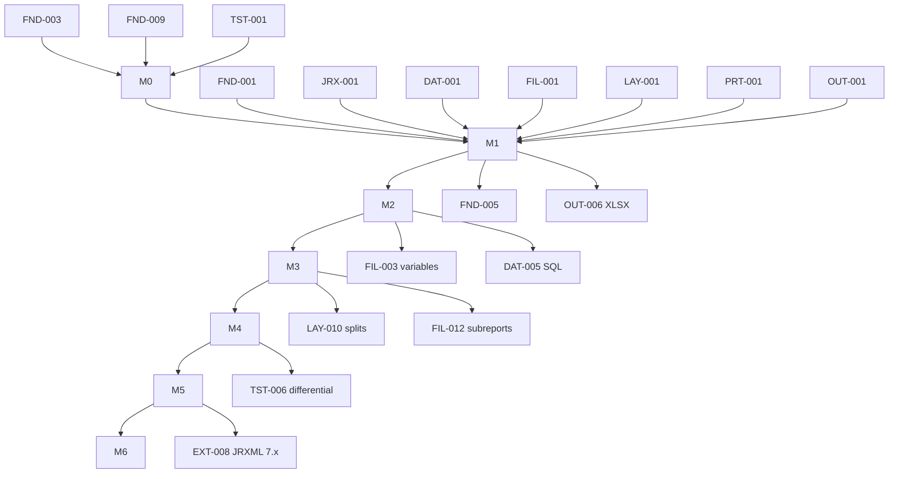

# Roadmap

> **Not date-based.** Milestones are ordered by dependency (`M0`…`M6+`), not by
> calendar time. No dates or effort estimates are commitments. Feature status
> is canonical in [`FEATURE_MATRIX.md`](FEATURE_MATRIX.md); task status is
> canonical in [`tasks/INDEX.md`](tasks/INDEX.md).

## Scope tiers

- **Minimum usable:** M0–M1 — a report with a static subset of JRXML, fields
  from a simple data source, and PDF output.
- **Production v1:** M2–M4 — real data sources, types, pagination, groups and
  multiple formats.
- **Long-term compatibility:** M5–M6+ — hardening, differential coverage, 7.x,
  advanced elements, optional service.

## Milestones

### M0 — Baseline and contracts

- **Outcome:** Agreed contracts and a deterministic test foundation, no report
  features.
- **Includes:** `FND-003`, `FND-009`, `FND-001` (contract), `FND-011` (already
  done), `JRX-001` (contract), `JRX-022`, `DAT-002`, `EXP-001` (contract),
  `EXP-019`, `PRT-001` (contract), `TST-001`, `OPS-008`.
- **Prerequisites:** bootstrap scaffold (present).
- **Demo/fixtures:** contract docs, `internal/diag`/`internal/limits`/
  `internal/testutil` skeletons, fixture conventions.
- **Exit criteria:** public API/IR/error/cancellation contracts documented and
  reviewed; deterministic test helpers available; compatibility register
  established; dependency/license policy recorded.
- **Not included:** any report parsing/filling/rendering.
- **Risks:** over-committing contracts too early; mitigate by marking proposals
  and deferring details to their first consumer.
- **Unlocks:** M1.

### M1 — First vertical slice (walking skeleton)

- **Outcome:** A narrow JRXML template with fields from a Go slice produces a
  single/multi-page PDF.
- **Includes:** `FND-001`, `FND-002`, `FND-006`, `JRX-001`..`JRX-004`,
  `JRX-008`, `JRX-010`, `JRX-014`, `JRX-019`, `EXP-001`, `EXP-003`, `EXP-004`
  (within `EXP-003`), `EXP-006`, `DAT-001`, `FIL-001`, `FIL-002`, `LAY-001`..
  `LAY-003`, `LAY-005`, `LAY-006`, `PRT-001`, `PRT-002`, `PRT-007`, `OUT-001`,
  `OUT-002`, `OUT-009`, `OUT-010`, `TST-002`, `TST-009`, `OPS-001`.
- **Prerequisites:** M0.
- **Walking skeleton (must cross every stage):**
  ```mermaid
  flowchart LR
    A[JRX-001 parse] --> B[JRX-002/3/4/8/10/14 model]
    B --> C[compiler: immutable IR]
    C --> D[DAT-001 slice source]
    D --> E[FIL-001/2 fill]
    E --> F[LAY-001/2/3+5/6 layout]
    F --> G[PRT-001/2/7 print IR]
    G --> H[OUT-001/2 PDF]
  ```
- **Demo/fixtures:** a template with title/pageHeader/detail/pageFooter, a few
  `textField`s bound to `$F{}`, a slice data source, PDF golden.
- **Exit criteria:** `make check` passes; golden PDF is byte-stable; unknown
  JRXML constructs produce diagnostics; cancellation tests pass.
- **Not included:** groups, variables, SQL/JSON/CSV, images, wrapping, XLSX/
  HTML/CSV.
- **Risks:** text metrics determinism (`LAY-006`), PDF library choice (`OUT-001`).
- **Unlocks:** M2.

### M2 — Real-world tabular reports

- **Outcome:** SQL/JSON/CSV sources, typed expressions, measured text, wrapping
  and pagination.
- **Includes:** `JRX-006`, `JRX-011`, `JRX-020`, `EXP-007`..`EXP-016`,
  `DAT-003`..`DAT-008`, `FIL-008`, `LAY-004`, `LAY-008`, `LAY-011`, `LAY-012`,
  `LAY-014`, `LAY-015`, `PRT-003`, `OUT-003`, `OUT-004`, `TST-003`, `TST-004`,
  `TST-007`, `TST-009`, `TST-012`, `OPS-003`.
- **Prerequisites:** M1.
- **Exit criteria:** page counts correct across fixtures; typed/decimal
  arithmetic tested; SQL injection and URI tests pass.
- **Not included:** groups/variables (`FIL-003`+), subreports, XLSX/HTML/CSV.
- **Unlocks:** M3.

### M3 — Reporting semantics

- **Outcome:** Groups, variables, reset semantics, delayed evaluation,
  multi-column.
- **Includes:** `JRX-005`, `JRX-007`, `JRX-009`, `JRX-013`, `JRX-015`,
  `EXP-012`, `EXP-013`, `EXP-017`, `DAT-009`, `DAT-010` (partial), `FIL-003`..
  `FIL-011`, `FIL-014`, `LAY-009`, `LAY-010`, `LAY-016`, `LAY-018`, `PRT-004`,
  `OUT-005`, `FND-004`, `OPS-007`.
- **Prerequisites:** M2.
- **Exit criteria:** group/variable fixtures pass at every band; reset scopes
  verified; pagination with delayed values verified.
- **Unlocks:** M4.

### M4 — Composition and formats

- **Outcome:** Subreports, images, XLSX, HTML, CSV, resource handling.
- **Includes:** `JRX-012`, `JRX-016`, `JRX-017`, `JRX-018`, `JRX-023`,
  `FIL-012`, `FIL-013`, `LAY-013`, `OUT-006`, `OUT-007`, `OUT-008`, `FND-005`,
  `OPS-002`, `OPS-004`.
- **Prerequisites:** M3.
- **Exit criteria:** subreport recursion bounded; each format has semantic
  tests; resource allowlist enforced.
- **Unlocks:** M5.

### M5 — Compatibility and hardening

- **Outcome:** Differential coverage, Unicode, performance, security,
  concurrency; compatibility gates.
- **Includes:** `FND-007`, `FND-010`, `LAY-007`, `LAY-017`, `PRT-005`,
  `TST-005`, `TST-006`, `TST-008`, `TST-010`, `TST-011`, `TST-012`, `OPS-005`,
  `OPS-006`, `OPS-009`, `OPS-010`, `OPS-011`, `DAT-010`.
- **Prerequisites:** M4.
- **Exit criteria:** compatibility matrix statuses backed by fixtures;
  benchmarks with declared hardware; no known data races/leaks.
- **Unlocks:** M6+.

### M6+ — Advanced extensions (deferred)

- **Outcome:** Charts, crosstabs, barcodes, translucency/PDF-A, accessibility,
  JRXML 7.x, optional service adapters, designer integrations.
- **Includes:** `EXT-001`..`EXT-009`, `JRX-021` (decision), `JRX-024`.
- **Prerequisites:** M5.
- **Exit criteria:** per-feature, defined when scheduled.

## Dependency DAG



Feature-level dependencies live in [`FEATURE_MATRIX.md`](FEATURE_MATRIX.md) and
task-level dependencies in [`tasks/INDEX.md`](tasks/INDEX.md). All references
resolve; the graph is acyclic and milestone-ordered.

## Deliberately deferred

- Compiled `.jasper` binary support (`JRX-021`, `Deferred`).
- Alternative expression languages (`EXP-018`, `Deferred`).
- Print IR serialization as a public format (`PRT-006`, `Deferred`).
- All of M6+ (`EXT-*`).

## Critical path

`FND-003`/`FND-009`/`PRT-001`/`DAT-002`/`EXP-001` contracts (M0) → `JRX-001` →
`JRX-008` → compiler → `DAT-001` → `FIL-001` → `LAY-001`/`LAY-003` →
`PRT-001` impl → `OUT-001` → M2 typed/pagination work → M3 groups.

See [`tasks/INDEX.md`](tasks/INDEX.md) for parallel-safe queues.
