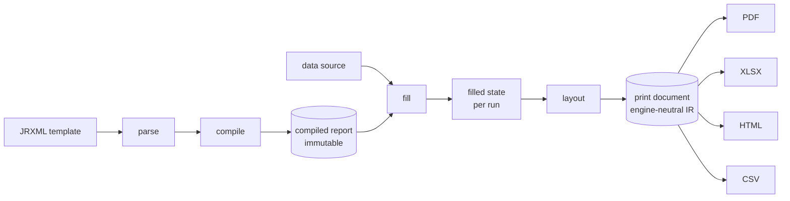

# Architecture

> **Status: scaffold only.** No engine functionality is implemented yet. This
> document records the intended boundaries so future changes can implement them
> in small, reviewable steps without reorganizing the repository.

## Principles

- **Library first.** The reporting engine is a native Go library that can be
  embedded in an application. The CLI and any future server adapter are thin
  consumers of the same core.
- **No JVM at runtime.** The engine targets pure-Go execution. Any Java-based
  reference tooling is a separate, optional testing concern (see
  `docs/compatibility.md`).
- **Immutable compiled reports, isolated fill state.** A compiled report is
  immutable and safe to reuse. Each fill execution owns its own mutable state.
- **Engine-neutral print IR.** The print document is the boundary between
  layout and exporters. Exporters consume the print document and know nothing
  about JRXML, expressions or data sources.

## Intended lifecycle

The stages are deliberately ordered: parsing and data sources feed compilation
and filling; layout produces the print representation; exporters consume it.

## Package responsibilities

| Package | Responsibility | Intended dependencies |
| --- | --- | --- |
| `internal/jrxml` | Parse JRXML XML into a template model. | standard library |
| `internal/compiler` | Validate a parsed template and produce an immutable compiled report. | `jrxml`, `expression` |
| `internal/expression` | Parse and evaluate report expressions. | standard library |
| `internal/datasource` | Pluggable business data providers. | standard library |
| `internal/fill` | Execute a compiled report against a data source; hold per-run state. | `compiler`, `expression`, `datasource` |
| `internal/layout` | Lay out filled data into pages, handling bands and page breaks. | `fill` |
| `internal/printdoc` | Engine-neutral print document model. | standard library |
| `internal/exporter` | Render a print document to output formats. | `printdoc` |

Dependencies flow from left (inputs) toward output; the graph must stay
acyclic. Interfaces should be introduced only when a second real
implementation or consumer exists, not preemptively.

## Public API surface

There is intentionally **no public `pkg/` hierarchy** in the scaffold. When a
stable public API is needed, it belongs at the module root (or another
consciously chosen stable path) and should be introduced with its first real
consumer. Prefer immutability, explicitness and small interfaces.

## Consumers

The same core serves three deployment shapes:

- **Embedded library** — applications import the module directly.
- **CLI** (`cmd/gosper`) — a local command-line front end, currently metadata only.
- **Service adapter** (future) — an optional network front end built on the library.

Keeping these consumers thin is what makes a shared core viable.

## Non-goals for the initial milestone

The bootstrap explicitly does not include: JRXML parsing, expression
evaluation, data sources, fill execution, layout, pagination, any exporters, a
network service, a report designer, a plugin system, or a Java runtime.
