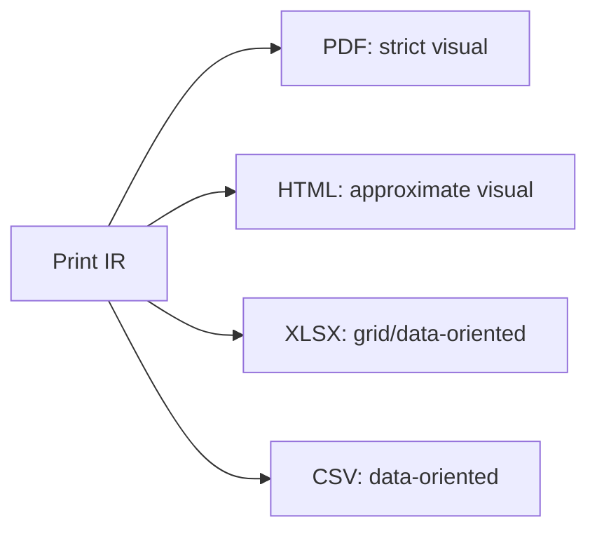

# Exporters

## Purpose and scope

Define the contract between the print IR and format encoders in
`internal/exporter`, and explain why exporters are **not** interchangeable in
semantics (PDF/visual vs XLSX/CSV/data-oriented).

## Contract

An exporter consumes a print document and writes bytes to an `io.Writer`. It
must not import parser, compiler, expression or fill packages. It may depend on
`internal/printdoc` and shared encoding utilities.

```go
// Proposed — non-binding.
type Exporter interface {
    Name() string
    Export(ctx context.Context, doc *printdoc.Document, w io.Writer) error
}
```

## Two families



| Family | Formats | Preserves | Tolerance |
| --- | --- | --- | --- |
| Visual | PDF (first), HTML | positions, fonts, shapes | tight (PDF), approximate (HTML) |
| Data/grid | XLSX, CSV | values, cell/row semantics | structural, not pixel |

CSV and XLSX **do not** render layout geometry the same way PDF does; they map
elements to cells/rows. This asymmetry is intentional and documented in
[`COMPATIBILITY.md`](../COMPATIBILITY.md).

## PDF baseline

- `OUT-001` establishes page output; `OUT-002` adds text; `OUT-003` adds
  vector/images; `OUT-004` embeds fonts; `OUT-005` adds metadata/links.
- Output streams to `io.Writer` (`OUT-009`) and is deterministic (`OUT-010`).

## Determinism

- Font subsetting order, object numbering and compression must be stable for
  identical input (`OUT-010`).
- Timestamps in metadata must be fixed/injected in tests, not wall-clock.

## Failure modes

- Write errors surface immediately; partial output is the caller's concern.
- Unsupported element in a format → explicit diagnostic, not silent drop.

## Traps and tests

- Do not let exporters "fix" layout; if geometry is wrong, fix layout.
- Golden tests must tolerate only documented differences (`TEST_STRATEGY.md`).

## Linked features and tasks

- `OUT-001` — task `OUT-001-001`; `OUT-002` (M1); `OUT-009`/`OUT-010` —
  `OUT-010-001`.
- Later: `OUT-003`..`OUT-008`; `EXT-004`/`EXT-005`.

## Assumptions and unresolved alternatives

- **Unresolved:** PDF library choice (pure-Go vs substantial dependency) — OQ-5.
  Decision by task `OUT-001-001` / an ADR if a dependency is added.
