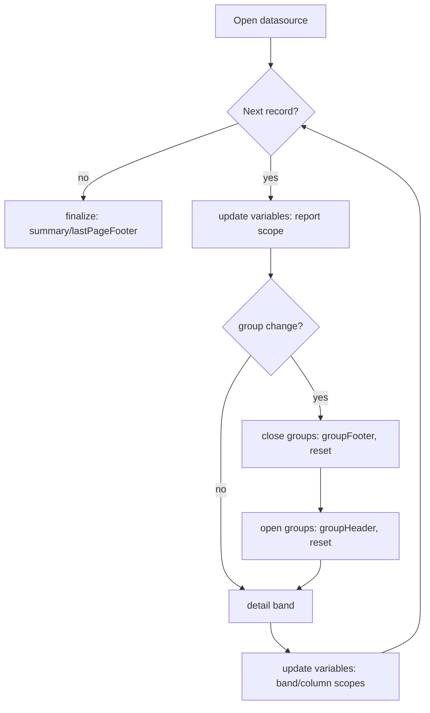

# Filling and groups

## Purpose and scope

Define record iteration, built-in variables, variable calculations, reset
semantics, group events and subreport boundaries in `internal/fill`.

## Fill state

A fill creates exactly one state object per run. It holds current record,
variable values, group status, and counters. It is **never shared** across runs.

## Record iteration

## Evaluation order (per record)

1. Increment **report-scope** variables (`Now`/`Report` increments).
2. Detect group boundary; emit group footers (old groups, innermost first) and
   reset their variables.
3. Emit group headers (outermost first) and reset their variables.
4. Emit the detail band.
5. Increment **column/band-scope** variables as configured.

The exact ordering is a correctness-critical contract; changes require an ADR.

## Variable calculations

- Built-ins: `PAGE_NUMBER`, `COLUMN_NUMBER`, `REPORT_COUNT`, plus common
  aggregate calculation types (`FIL-002`, `FIL-003`).
- Calculation types: `Count`, `Sum`, `Average`, `Min`, `Max`, `DistinctCount`
  (`FIL-004`). Each requires explicit reset type semantics.
- **Reset types:** `None`, `Report`, `Page`, `Column`, `Group`.

## Groups

- Group boundary is detected by evaluating the group expression and comparing
  with the previous value.
- Nested groups close/footers inner-first, then open outermost-first.
- Group page breaks and reprinted headers are layout-triggered but fill-ordered
  (`FIL-007`).

## Deferred evaluation

`PAGE_NUMBER`/`PAGE_COUNT` and layout-affecting delayed expressions are resolved
after pagination, requiring a second pass or reservation (`FIL-010`).
Total-page values depend on pagination; document the strategy before
implementing (`LAY-016`).

## Subreports

Subreports run an independent fill (own state, own dataset) and return values
to named return variables. Recursion must be bounded (`FIL-012`, `FIL-013`).

## Failure modes and cancellation

- Data source error → abort, close cursor.
- Fold overflow / limits exceeded → diagnostic (`OPS-001`, `OPS-007`).
- Cancellation checked per record.

## Traps and tests

- Group reset bugs are subtle; use fixtures with multiple nested groups and
  assert variable values at each band (`TST-003`).
- Concurrent fills of one compiled report must be race-free (`TST-009`).

## Linked features and tasks

- `FIL-001` iteration — task `FIL-001-001`.
- `FIL-002` built-ins — task `FIL-002-001`.
- `FIL-003`..`FIL-014` — see [`FEATURE_MATRIX.md`](../FEATURE_MATRIX.md).

## Assumptions and unresolved alternatives

- **Unresolved:** whether pagination influences variable values requiring a
  fixed-point iteration; tracked by `FIL-010`/`LAY-016`.
