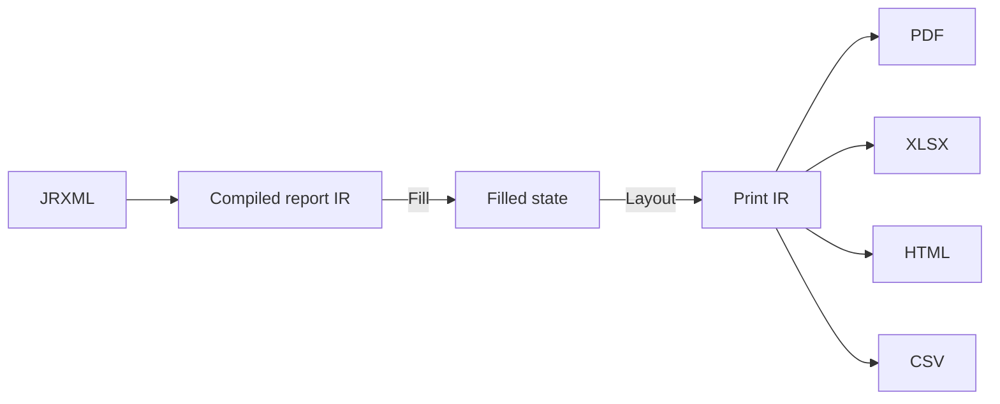

# Intermediate representations

## Purpose and scope

Define the two intermediate representations and their boundary: the
**compiled report IR** (semantic, immutable) and the **print IR** (paginated,
visual). Explain persistence, cache and serialization caveats.

## The two IRs

| Aspect | Compiled report IR | Print IR |
| --- | --- | --- |
| Contains | validated template semantics, resolved styles, expression programs | pages with positioned elements and resolved style values |
| Mutability | immutable, shareable | produced per run, consumed once by an exporter |
| Depends on data? | no | yes (filled values already baked in) |
| Depends on geometry? | no absolute coordinates | absolute coordinates, measured text |
| Owner package | `internal/compiler` | `internal/printdoc` |
| Cacheable? | yes (versioned key) | no |

## Why split

A single IR cannot serve both roles without coupling: compilation must not
depend on data, and exporters must not depend on report semantics
(`ADR-0002`). The split keeps exporters simple and compile results reusable.

## Compiled IR contents (proposed)

- Report metadata (name, page size, margins, columns).
- Parameter, field and variable declarations.
- Expression programs (compiled AST) bound to symbols.
- Band definitions with element trees and style references.
- Resolved style table.

*Proposed interface — non-binding:* the IR is exposed as an opaque,
read-only value; consumers do not get setters.

## Print IR contents (proposed)

- Page list with size and metadata (`PRT-007`).
- Per-page element list: text runs, images, vector shapes, with absolute
  coordinates and resolved style values (`PRT-002`).
- Resource references (font/image handles) rather than raw bytes where
  possible (`PRT-003`).

## Persistence and caching caveats

- **Compiled IR persistence is deferred** (`PRT-006`). If added, it requires a
  stable schema version and a decision on format; do not assume Go
  `gob`/`encoding/json` stability across releases.
- **Cache keys must include** template content hash, compiler schema version,
  and relevant environment flags (`FND-004`). Never key on file path alone.
- **Print IR is not persisted** in early milestones. Spill-to-disk
  (`PRT-005`) is an internal storage concern, not a public file format.

## Traps and tests

- Exporters reaching into semantic fields is forbidden by
  [`package-boundaries.md`](package-boundaries.md); tests should assert the
  import graph.
- Cache invalidation tests must change a template flag and assert a different
  compiled IR (`FND-004`).

## Linked features and tasks

- `PRT-001` Typed print document — tasks `PRT-001-001`, `PRT-001-002`.
- `PRT-002` Resolved styles — task `PRT-002-001`.
- `FND-004` Compile cache; `PRT-005` spill-to-disk; `PRT-006` serialization.
- Decision: [`adr/0002-split-compiled-ir-from-print-ir.md`](../adr/0002-split-compiled-ir-from-print-ir.md).

## Assumptions and unresolved alternatives

- **Unresolved:** internal unit system (twips vs points vs sub-point integers)
  for the print IR. Tracked in [`FEATURE_MATRIX.md`](../FEATURE_MATRIX.md) open
  questions and by `PRT-001-001`.
- **Unresolved:** whether print IR is a value model or a streaming event
  stream. `PRT-004`/`OUT-009` decide.
