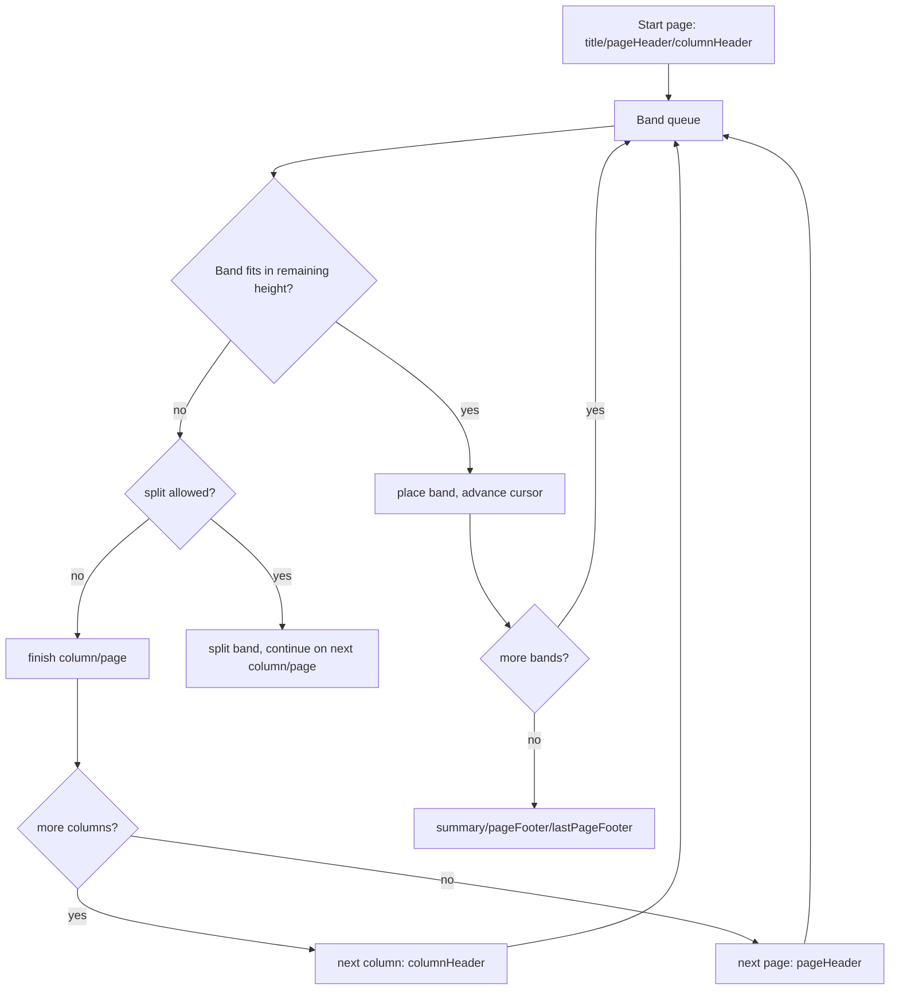

# Layout and pagination

## Purpose and scope

Define page geometry, band placement, text measurement, dynamic sizing, split
behavior and page breaking in `internal/layout`, and how measured results become
the print IR.

## Geometry model

- Page size and margins come from the compiled IR (`JRX-002`).
- `layout.PageGeometry.PrintableArea` subtracts margins in twips and rejects
  invalid dimensions. `Canvas.Place` advances a fixed-height band cursor and
  appends a page when the next band would overflow; an oversized band errors.
- All coordinates are absolute within a page's printable area; the internal
  unit system is an open decision (`PRT-001-001`, OQ-2).
- Band origin tracks a current vertical cursor; elements position relative to
  their band.
- `Canvas.AbsoluteBounds` adds a band's absolute origin to element offsets.
  M1 rejects elements extending beyond the printable width or band height;
  `PlaceText` appends accepted text to the corresponding print page.

## Layout flow

## Text measurement

- A font resolver maps logical fonts to metric providers (`LAY-005`).
- `internal/text.Resolve` maps SansSerif, Serif and Monospaced names to
  bundled, original ASCII metric tables. Empty or unknown names fall back to
  SansSerif; non-ASCII runes use a fixed advance. There are no font binaries or
  third-party assets to license in M1. Bold/italic are recorded for later
  rendering; M1 widths use the same family metrics for every style.
- Measurement must be deterministic given the same font set and locale
  (`LAY-015`); shaping/Unicode fallback is later (`LAY-007`).
- `text.Measure` sums nominal rune advances and rounds once to twips. It
  returns width, ascent (0.8 em), descent (0.2 em), and line height (1.2 em).
  It accepts one line of UTF-8 up to 1 MiB, keeps no cache, and rejects
  multiline input. These are M1 baseline metrics, not shaped glyph positions.
- Line breaking, clipping, alignment and rotation consume measured metrics
  (`LAY-008`).

## Dynamic sizing and splits

- Bands may grow to fit content (`LAY-004`, `LAY-010`).
- Split types (`Prevent`, `Stretch`, `Immediate`) and overflow continuation
  control how a band crosses a page boundary (`LAY-010`).
- Keep-together, orphans/widows and reserved page counts interact with
  pagination (`LAY-011`, `LAY-016`).

## Output to print IR

Layout resolves each element's final position, bounds and resolved style values
and appends them to the current page in `internal/printdoc` (`PRT-001`,
`PRT-002`). After this stage, no layout information remains in semantic form.

## Failure modes

- Content that cannot fit even on a fresh page → diagnostic (no infinite loop).
- Unresolvable font → deterministic fallback or diagnostic, never a panic.
- Cancellation checked between bands and pages.

## Traps and tests

- Pagination is the highest-risk area: test page counts and break positions
  with golden + semantic assertions (`TST-004`).
- Floating coordinate drift can break determinism; prefer integer/scaled units
  and test convergence (`LAY-015`).

## Linked features and tasks

- `LAY-001` geometry — task `LAY-001-001`; `LAY-002` — `LAY-002-001`;
  `LAY-003` — `LAY-003-001`; `LAY-005` — `LAY-005-001`; `LAY-006` —
  `LAY-006-001`.
- Later: `LAY-004`, `LAY-008`..`LAY-018`.

## Assumptions and unresolved alternatives

- **Unresolved:** internal unit (twips/points/sub-point) — OQ-2.
- **Unresolved:** text shaping backend — OQ-3.
