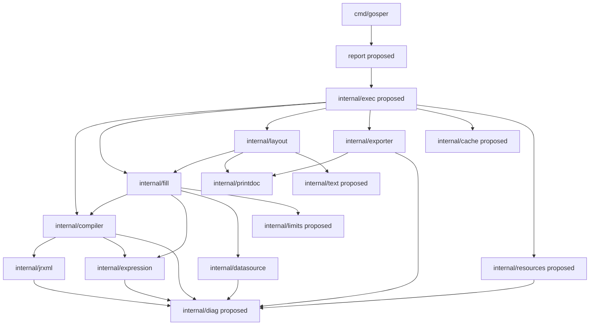
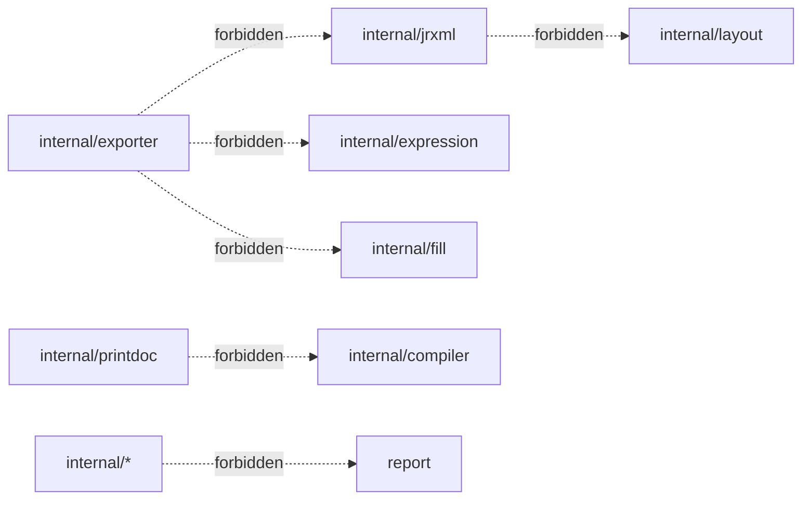

# Package boundaries

## Purpose and scope

Define package ownership, the allowed dependency direction, and prohibited
imports, so parallel contributors (and agents) edit disjoint files and avoid
import cycles. This document is normative for new packages; existing package
names come from the bootstrap scaffold.

## Invariants

1. The import graph is **acyclic** and flows from inputs toward output.
2. Exporters depend only on the print IR (`internal/printdoc`), never on the
   parser, compiler, expression, fill or layout packages.
3. The public API package (`report`, *proposed*) may depend on `internal/*`,
   but no `internal/*` package may depend on `report`.
4. `internal/printdoc` depends only on the standard library (plus, if ever
   needed, a tiny value-type package) and has no knowledge of JRXML.
5. `internal/expression` does not import `internal/jrxml` or `internal/fill`;
   symbol resolution is injected by callers.

## Component diagram



Forbidden edges (must never exist):



## Ownership table

| Package | Owns | Must not contain |
| --- | --- | --- |
| `report` *(proposed)* | Public types and lifecycle entry points; error facade. | Parsing/layout/rendering logic. |
| `internal/exec` *(proposed)* | Orchestration, stage wiring, cancellation boundaries. | Format-specific logic. |
| `internal/diag` | Error codes, severity, spans, formatting. | Business logic. |
| `internal/jrxml` | XML decoding, version detection, normalization. | Evaluation, layout, IO beyond the reader. |
| `internal/compiler` | Validation, compiled IR construction. | Runtime state, rendering. |
| `internal/expression` | Grammar, AST, evaluation, function registry. | Symbol storage (injected), IO. |
| `internal/datasource` | Cursor interfaces and concrete sources. | Layout/print concerns. |
| `internal/fill` | Per-run state, iteration, aggregation. | Coordinate/geometry math beyond what layout needs as input. |
| `internal/layout` | Band placement, measurement, pagination. | Format encoding, JRXML parsing. |
| `internal/printdoc` | Print IR value types and page metadata. | Back-references to source packages. |
| `internal/exporter` | Format encoders (PDF, XLSX, HTML, CSV). | Parsing, filling, layout. |
| `internal/text` *(proposed)* | Font metrics, shaping, line breaking. | Report semantics. |
| `internal/cache` *(proposed)* | Versioned compile cache. | Report semantics. |
| `internal/resources` *(proposed)* | Resource URI resolution and allowlists. | Format-specific rendering. |
| `internal/limits` | Budgets, cancellation helpers, counters. | Feature logic. |
| `internal/testutil` | Deterministic clock/locale/timezone helpers. | Non-test production code. |

## Interfaces

`DataSource`/`Cursor`/`Record` are defined in `internal/datasource` (`DAT-002`,
**Done**). `Resolver` remains proposed:

```go
// Implemented — internal/datasource.

// DataSource yields records for a dataset. Implementations own their cursor;
// Next returns (nil, false, nil) when exhausted or after Close; Close is
// idempotent.
type DataSource interface {
    Open(ctx context.Context) (Cursor, error)
}

type Cursor interface {
    Next(ctx context.Context) (Record, bool, error)
    Close() error
}
```

```go
// Proposed interface — non-binding.

// Resolver resolves logical resource names to readers, enforcing allowlists.
type Resolver interface {
    Open(ctx context.Context, ref string) (io.ReadCloser, error)
}
```

## Failure modes and error propagation

- Each package returns typed errors wrapped with `fmt.Errorf("...: %w", err)`.
- `internal/diag` codes are attached at the lowest layer that can identify the
  failure; callers add context, not codes.
- Cancellation (`context.Canceled`, `context.DeadlineExceeded`) propagates
  unchanged; it is never reported as a generic engine error.

## Performance and correctness traps

- Importing `internal/text` from `internal/fill` would create an unwanted
  dependency; keep measurement on the layout side.
- Sharing a mutable cursor across goroutines is a data race.
- Letting `internal/exporter` import `internal/fill` tempts exporters to
  recompute semantics; resolve everything into the print IR instead.

## Linked features and tasks

- `FND-001` Public SDK surface — task `FND-001-001`.
- `FND-003` Error model — task `FND-003-001`.
- `PRT-001` Print document model — task `PRT-001-001`.
- `DAT-002` Data source interface — task `DAT-002-001`.

## Assumptions and unresolved alternatives

- **Assumption:** the public package is named `report` at the module root.
  Alternative: a `/gosper` or `/report` subpackage. Decision deferred to
  `FND-001-001`; see [`CONTRIBUTING_TASKS.md`](../CONTRIBUTING_TASKS.md).
- **Unresolved:** whether `internal/exec` exists or orchestration lives in
  `report`. Tracked by task `FND-001-001`.
