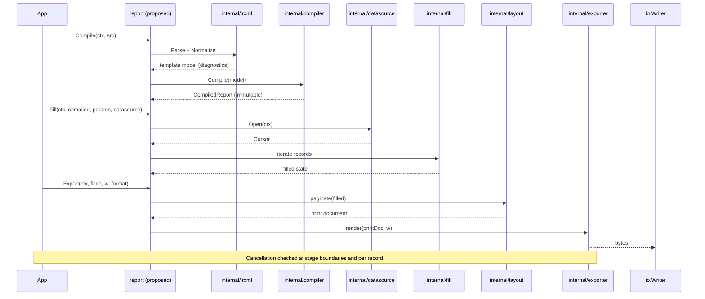

# Report lifecycle

## Purpose and scope

Describe how data moves through the canonical lifecycle — parse → normalize →
compile → fill → layout → export — including object ownership, failure points
and cancellation boundaries. This is the reference for
[`ROADMAP.md`](../ROADMAP.md) M1's walking skeleton.

## Stage contracts

| Stage | Input | Output | Ownership of output |
| --- | --- | --- | --- |
| Parse | JRXML bytes + `Resolver` | template model | per-call; discarded after compile |
| Normalize | template model | version-normalized model | per-call |
| Compile | normalized model | **immutable** compiled report | reusable/cacheable |
| Fill | compiled report + `DataSource` + params | filled state (per run) | per-run; never shared |
| Layout | filled state + text metrics | print document | per-run |
| Export | print document + writer | encoded bytes | caller's writer |

## Sequence diagram



Failure/cancellation points (each must short-circuit to the caller):

1. Parse/normalize errors → diagnostics with source spans (`FND-003`, `JRX-019`).
2. Compile validation errors → compiled report is not produced.
3. `Open`/`Next` errors in the data source → fill aborts; cursor closed.
4. `ctx` cancellation → checked before each stage and per record; returned as
   `context.Canceled`/`DeadlineExceeded`.
5. Layout overflow that cannot be resolved → diagnostic, no partial print doc.
6. Exporter write error → surfaced without buffering the whole document when
   streaming is possible.

## Object ownership

- **Compiled report:** immutable; may be cached and shared across goroutines.
- **Cursor / record:** owned by the fill run; `Close` is guaranteed.
- **Filled state:** owned by one run; never stored in the compiled report.
- **Print document:** owned by the run; handed to the exporter by reference and
  not mutated after handing off.

## Proposed contracts — non-binding

```go
// Proposed — non-binding.
type CompiledReport interface {
    // Immutable; safe for concurrent Fill calls.
}

type FilledReport interface {
    // Per-run; not safe for concurrent use.
}
```

## Determinism and environment

Output depends on font metrics, locale, timezone and platform. These are
injected through `internal/testutil` (proposed) for tests. See
[`TEST_STRATEGY.md`](../TEST_STRATEGY.md).

## Traps and tests

- Reusing a filled state across runs is a bug; tests must assert fill isolation
  (`TST-009`).
- Cancelling mid-iteration must not leak the cursor or goroutines (`TST-009`).
- Compile determinism: compiling identical input twice yields equal compiled IR.

## Linked features and tasks

- `FND-001` Public SDK — task `FND-001-001` (contract), `FND-001-002` (wiring).
- `FIL-001` Record iteration — task `FIL-001-001`.
- `LAY-001` Page geometry — task `LAY-001-001`.
- `OUT-001` Baseline PDF — task `OUT-001-001`.
- `OPS-001` Resource limits — task `OPS-001-001`.

## Assumptions and unresolved alternatives

- **Assumption:** compile and fill are separate public calls, with an optional
  convenience wrapper.
- **Unresolved:** whether normalization is a distinct stage or part of parse.
  Tracked by `JRX-020`.
